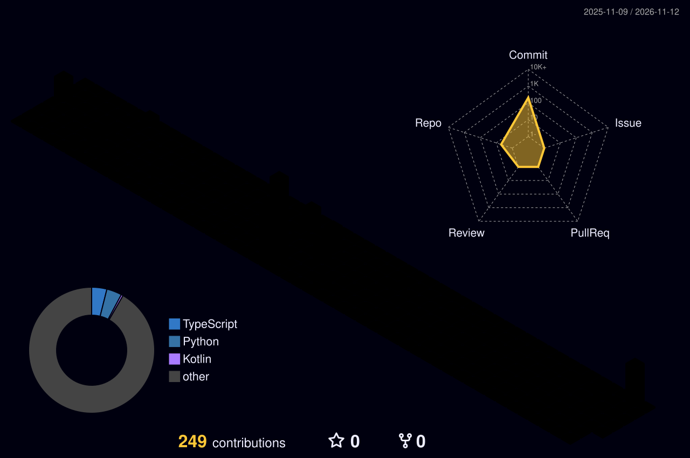

<h2>nmL &nbsp;·&nbsp; eXLu51ve</h2>

  <b>Android-разработчик</b> · Kotlin · Jetpack Compose · game dev на Unreal 
  Автор <b>HETERO</b> — учёт смен и расчёт зарплаты

  
  
  
  

  

---

<!-- ───────────────────────── ЗМЕЙКА ───────────────────────── -->

<picture>
  <source media="(prefers-color-scheme: dark)"
          srcset="https://raw.githubusercontent.com/eXLu51ve-gjj/eXLu51ve-gjj/output/github-contribution-grid-snake-dark.svg" />
  <source media="(prefers-color-scheme: light)"
          srcset="https://raw.githubusercontent.com/eXLu51ve-gjj/eXLu51ve-gjj/output/github-contribution-grid-snake.svg" />
  
</picture>

---

<!-- ───────────────────────── ПРОЕКТЫ ───────────────────────── -->

## ⚡ Что делаю

<table>
<tr>
<td width="55%" valign="top">

### 📱 HETERO

Android-приложение для тех, кто работает посменно: считает зарплату с ночными,
выходными, праздниками и сверхурочными, строит график 2/2 и недели A/B,
показывает аналитику и умеет экспорт в PDF/CSV.

`Kotlin` · `Jetpack Compose` · `Room` · `DataStore` · `WorkManager` · `виджеты`

Репозиторий закрытый · готовится релиз в RuStore

</td>
<td width="45%" valign="top">

### 🧰 Другие проекты

- [**AuF-Network-Tools**](https://github.com/eXLu51ve-gjj/AuF-Network-Tools) — сетевые утилиты, TypeScript
- [**network-scanner**](https://github.com/eXLu51ve-gjj/network-scanner) — сканер сети
- [**SpeedtestFake**](https://github.com/eXLu51ve-gjj/SpeedtestFake) — Python, эксперименты со speedtest

</td>
</tr>
</table>

---

<!-- ───────────────────────── СТЕК ───────────────────────── -->

## 🛠 Стек

<table>
<tr>
<td valign="top" width="50%">

**Мобильная разработка**

**Языки**

</td>
<td valign="top" width="50%">

**Инфраструктура**

**Сети**

</td>
</tr>
</table>

---

<!-- ───────────────────────── 3D КОНТРИБУЦИИ ───────────────────────── -->

## 🧊 Контрибуции в 3D

  

---

<!-- ───────────────────────── СТАТИСТИКА ───────────────────────── -->

## 📊 Статистика

  

---

<!-- ───────────────────────── КОНТАКТЫ ───────────────────────── -->

## 📫 Связаться

&nbsp;&nbsp;
&nbsp;&nbsp;
&nbsp;&nbsp;
&nbsp;&nbsp;

  

